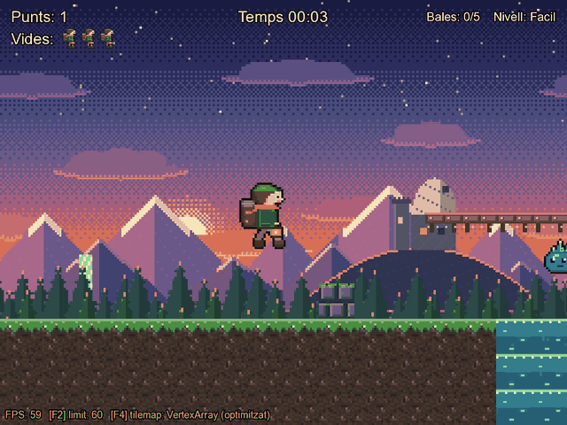
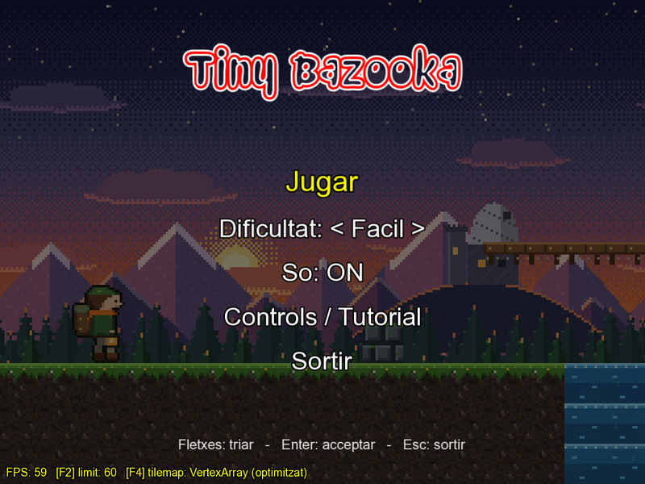
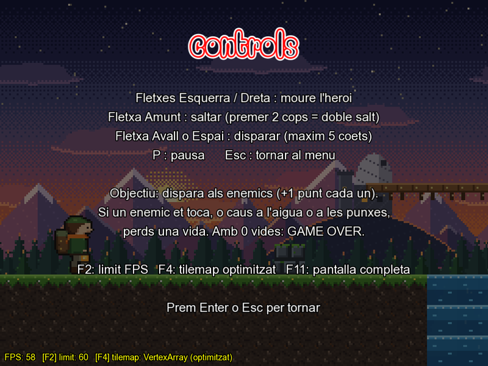
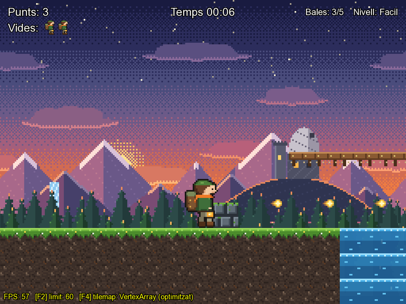
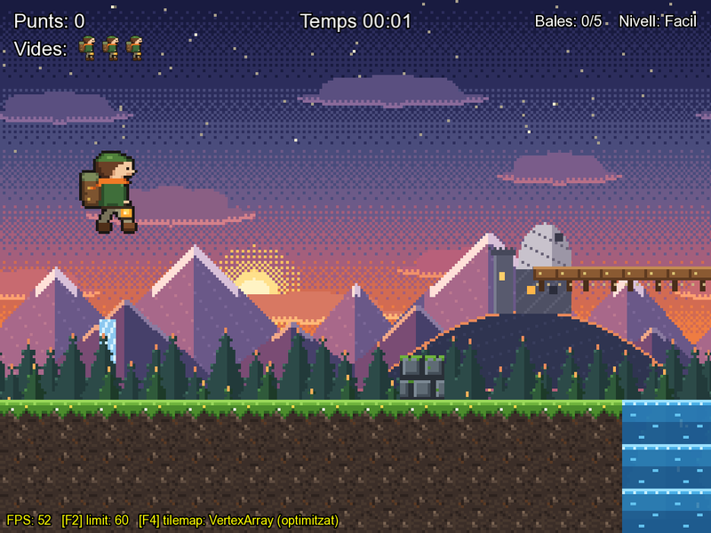
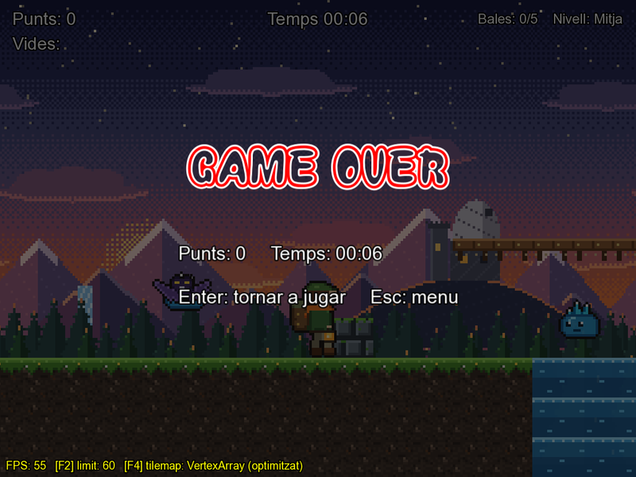
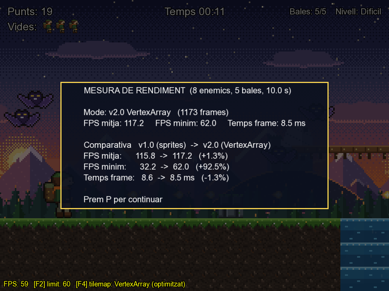
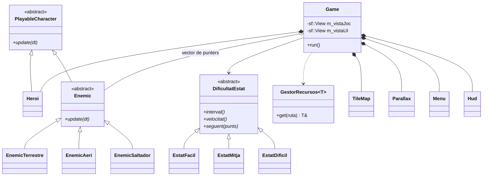
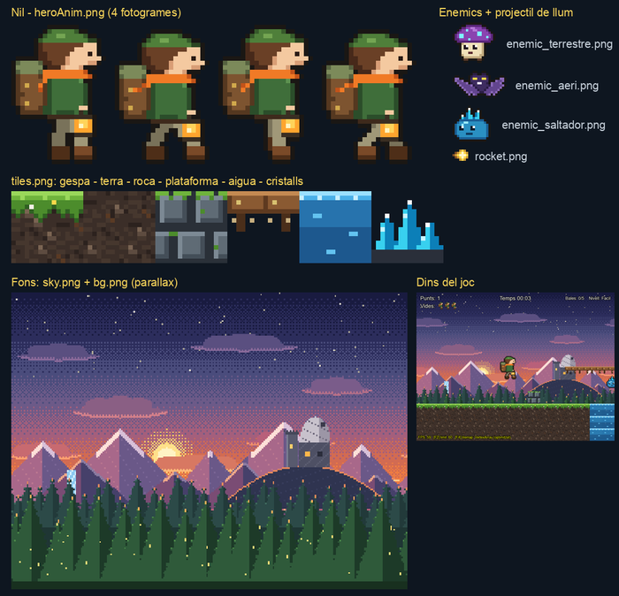

<div align="center">

# 🚀 Tiny Bazooka

**Juego de plataformas 2D en C++ con SFML 3**

Corre, salta y dispara cohetes a los enemigos de un mundo pixel art inspirado en el proyecto **Entre Dos Mons**.




</div>

---

## 📑 Índice

- [Capturas](#-capturas)
- [Características](#-características)
- [Controles](#-controles)
- [Compilar y ejecutar](#-compilar-y-ejecutar)
- [Arquitectura](#-arquitectura)
- [Editar el nivel](#-editar-el-nivel)
- [Rendimiento](#-rendimiento)
- [Robustez ante errores](#-robustez-ante-errores)
- [Assets](#-assets)

---

## 📸 Capturas

| Menú principal | Controles / Tutorial |
|:---:|:---:|
|  |  |
| **Partida: disparo y HUD** | **Doble salto** |
|  |  |
| **Game Over** | **Medición de rendimiento (F5)** |
|  |  |

---

## ✨ Características

- 🗺️ **Tilemap cargado desde texto**: el nivel se lee de `Assets/levels/nivell1.txt`. Tiene 8 tipos de casilla, con zonas sólidas, plataformas atravesables y zonas peligrosas (agua y pinchos).
- 🏃 **Personaje animado (Nil)**: animación por *spritesheet*, gravedad, salto y **doble salto**, y parpadeo de invulnerabilidad al recibir un golpe.
- 👾 **Tres tipos de enemigo**, todos con polimorfismo sobre `Enemic`:
  - 🍄 **Terrestre**: camina por el suelo.
  - 🦇 **Aéreo**: vuela haciendo ondas.
  - 💎 **Saltador**: avanza a saltos.
- 📊 **HUD**: puntuación, vidas restantes, tiempo de partida, cohetes disponibles y nivel de dificultad.
- 📋 **Menú de 5 opciones**: Jugar, Dificultad, Sonido ON/OFF, Controles/Tutorial y Salir. Se dibuja con una **segunda cámara** (`sf::View`) fija en pantalla.
- 🎚️ **Dificultad con el patrón Estado**: Fácil → Media → Difícil. La partida se acelera cada 5 puntos.
- 🌄 **Parallax** de dos capas: un cielo que se mueve solo y un paisaje que sigue a la cámara.
- 🖥️ **Pantalla completa** con franjas negras para mantener la proporción 4:3. Se cambia con `F11`.
- 📦 **`GestorRecursos<T>` genérico**: una plantilla única para texturas, fuentes y sonidos, con caché.
- ⏱️ **Benchmark integrado** (`F5`): siempre usa la misma escena para comparar la versión original con la optimizada.

---

## 🎮 Controles

| Tecla | Acción |
|---|---|
| `←` / `→` | Moverse |
| `↑` | Saltar (pulsa otra vez en el aire para el doble salto) |
| `↓` / `Espacio` | Disparar (máximo 5 cohetes a la vez) |
| `P` | Pausa |
| `Esc` | Volver al menú |
| `F2` | Activar o desactivar el límite de 60 FPS |
| `F4` | Cambiar el dibujado del mapa (VertexArray ↔ sprites) |
| `F5` | Lanzar la medición de rendimiento |
| `F11` | Pantalla completa ↔ ventana |

**En el menú:** `↑` / `↓` para elegir, `Enter` para aceptar y `←` / `→` para cambiar la dificultad o el sonido.

---

## 🛠️ Compilar y ejecutar

### Requisitos

- Windows 10 u 11.
- Visual Studio 2022 o 2026, con la carga de trabajo **Desarrollo para el escritorio con C++**.
- [SFML 3.0.0](https://www.sfml-dev.org/download/sfml/3.0.0/) para **Visual C++ 17 (2022), 64 bits**.

### Pasos

1. Descomprime SFML en **`C:\SFML64`**, de forma que exista `C:\SFML64\include\SFML\Graphics.hpp`.
2. Clona el repositorio y abre `Motor/PDGV_motor.sln`.
3. Selecciona **`x64`** y **`Debug`** o **`Release`**.
4. Compila y ejecuta con **`F5`**.

Las DLL de SFML ya están junto al proyecto. El juego carga `Assets/` con rutas relativas, así que el directorio de trabajo debe ser la carpeta `Motor/`.

<details>
<summary><b>❗ Problemas habituales</b></summary>

| Error | Solución |
|---|---|
| `C1083: no se puede abrir SFML/Graphics.hpp` | SFML no está en `C:\SFML64`. Instálalo ahí o cambia *Propiedades → C/C++ → Directorios de inclusión adicionales* y *Vinculador → Directorios de bibliotecas adicionales*. |
| `MSB8020: no se encuentran las herramientas de compilación v143` | Estás en Visual Studio 2026. Haz clic derecho sobre la solución y elige **Redestinar solución**, o pon el *Conjunto de herramientas de la plataforma* en **v145**. |
| Falta `sfml-graphics-3.dll` al ejecutar | Copia las DLL de `C:\SFML64\bin` a la carpeta `Motor/`. |
| Se ven texturas a cuadros magenta y negro | Falta una imagen de `Assets/graphics/`. El juego usa un sustituto y avisa por pantalla. |

</details>

---

## 🧱 Arquitectura



| Archivo | Responsabilidad |
|---|---|
| `Game` | Ventana, bucle principal, pantallas, **dos cámaras**, colisiones AABB y puntuación |
| `PlayableCharacter` → `Heroi` / `Enemic` | Base común con `update()` virtual |
| `EnemicTerrestre` / `EnemicAeri` / `EnemicSaltador` | Cada uno con su propio comportamiento |
| `TileMap` | Carga y validación del nivel, colisiones por eje y dibujado con `sf::VertexArray` |
| `DificultatEstat` + `Estat*` | Patrón Estado para la dificultad |
| `GestorRecursos<T>` | Plantilla *singleton* con caché de texturas, fuentes y sonidos |
| `Parallax` | Fondo con dos capas a velocidades distintas |
| `Menu` / `Hud` | Interfaz dibujada con la cámara fija |
| `Avisos` | Mensajes en pantalla cuando falta un recurso o el nivel tiene errores |
| `Config.h` | Todas las constantes y rutas en un único sitio |

---

## 🗺️ Editar el nivel

El nivel es un archivo de texto de **12 filas × 64 columnas**. Cada carácter es una casilla de 64×64 px:

| Símbolo | Casilla | Tipo |
|:---:|---|---|
| `.` | Vacío | — |
| `G` | Hierba | 🟩 sólida |
| `T` | Tierra | 🟫 sólida |
| `R` | Roca | ⬜ sólida |
| `P` | Plataforma | ↕️ atravesable desde abajo |
| `A` | Agua | ☠️ quita una vida |
| `S` | Pinchos | ☠️ quita una vida |
| `H` | Inicio del héroe | 📍 |

```text
............PPPPPP...........PPPPPPPP...........PPPPPPP.........
...........................R............R.......................
..H......R............SS..RR............R...SSS...........S.....
GGGGGGGGGGGGGGAAAGGGGGGGGGGGGGGAAAAGGGGGGGGGGGGGGGAAAGGGGGGGGGGG
TTTTTTTTTTTTTTAAATTTTTTTTTTTTTTAAAATTTTTTTTTTTTTTTAAATTTTTTTTTTT
TTTTTTTTTTTTTTAAATTTTTTTTTTTTTTAAAATTTTTTTTTTTTTTTAAATTTTTTTTTTT
```

Las líneas que empiezan por `#` son comentarios.

---

## ⚡ Rendimiento

Pulsa **`F5`** durante la partida. Durante 1 s de calentamiento y 10 s de medición, el juego repite siempre la misma escena: semilla fija, 8 enemigos, 5 cohetes y sin límite de FPS. Primero mide con un sprite por casilla (v1.0) y después con un único `sf::VertexArray` (v2.0).

| Métrica | v1.0 (sprites) | v2.0 (VertexArray) | Cambio |
|---|:---:|:---:|:---:|
| FPS medio | 115,8 | 117,2 | **+1,3 %** |
| FPS mínimo | 32,2 | 62,0 | **+92,5 %** |
| Tiempo por frame | 8,6 ms | 8,5 ms | **−1,3 %** |

> El FPS medio apenas cambia, pero el **mínimo casi se duplica**: con el `VertexArray` el mapa se dibuja en una sola llamada y desaparecen los tirones.

---

## 🛡️ Robustez ante errores

| Situación | Comportamiento |
|---|---|
| Falta una imagen o un sonido | Se usa un sustituto (textura a cuadros o sonido vacío) y aparece un aviso en pantalla |
| Falta `nivell1.txt` o está vacío | Se carga un nivel por defecto integrado |
| Caracteres incorrectos o filas irregulares en el nivel | Aviso con la línea y la columna, y se corrige automáticamente |
| Falta la fuente | Mensaje claro en la consola, en vez de cerrarse sin explicación |

---

## 🎨 Assets



Los tiles, el personaje (Nil), los enemigos y el fondo pixel art siguen la estética del proyecto **Entre Dos Mons**.

```text
Assets/
├── audio/      bgMusic.ogg · fire.ogg · hit.ogg
├── fonts/      SnackerComic.ttf · arial.ttf
├── graphics/   tiles · heroAnim · enemic_* · sky · bg · rocket
└── levels/     nivell1.txt
```

---

<div align="center">

Hecho por **Carlos Rodriguez** · DAM, La Salle Girona · Programación de Videojuegos (PGVI)

</div>
